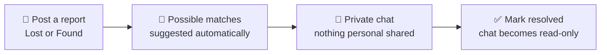

<div align="center">

<h1>🔍 Campus Lost & Found</h1>

<p><strong>Get lost things back to their owners.</strong><br>
Post what you lost or found, get matches suggested automatically, and chat privately — no phone numbers or emails shared.</p>

<p>
  
  
  
  
  
  
</p>

<p>
  <a href="#-features">Features</a> ·
  <a href="#-how-it-works">How it works</a> ·
  <a href="#-quick-start">Quick start</a> ·
  <a href="#-project-structure">Structure</a> ·
  <a href="#-more-details">Details</a>
</p>

</div>

---

<!--
📸 SCREENSHOTS — take 3 screenshots, save them in a docs/ folder, then delete this comment's start/end markers.

## 📸 Screenshots

<div align="center">
  
</div>

<table>
  <tr>
    <td width="50%"></td>
    <td width="50%"></td>
  </tr>
  <tr>
    <td align="center"><sub>Report detail & possible matches</sub></td>
    <td align="center"><sub>Private chat with "Seen"</sub></td>
  </tr>
</table>
-->

## ✨ Features

| | |
|---|---|
| 🔐 **Domain-locked sign-in** | Google login only. The email must be verified **and** belong to your institution's domain, checked on the server. Local sign-up is closed. |
| 🗂️ **Smart dashboard** | Lost / Found tabs, search (name, place, description), category and status filters, pagination. |
| 🎯 **Possible matches** | Open reports of the opposite type, in the same category, within 14 days and with shared words are suggested automatically. |
| 💬 **Private chat** | One-to-one chats between the poster and a visitor, with auto-refresh, unread badges, **Seen** indicator, date separators and multi-line messages. |
| 📸 **Photo upload** | Drag & drop, live preview, JPEG/PNG/WebP validation, 5 MB limit, automatic clean-up of replaced photos. |
| ✅ **Mark resolved** | AJAX with a confirm dialog and a stamp animation. Resolving makes the chat read-only. |
| 📬 **My reports & Messages** | Everything you posted and every conversation in one place, with unread counts. |
| 🎨 **Polished UI** | Ticket-style cards (red = Lost, teal = Found), light & dark theme, smooth animations, toasts, reduced-motion support. |
| 🛠️ **Admin tools** | Filters, inline status edit, bulk "mark resolved", read-only message inspection. |
| 🧪 **Tested** | 100+ automated tests for auth, CRUD, chat, permissions and matching. |

---

## 🧭 How it works



1. **Post a report** with a photo, the place and the date.
2. **Check the matches** — the app suggests similar reports from the other side, or someone messages you.
3. **Chat privately** — ask for details only the real owner would know, and meet in a public place.
4. **Mark it resolved** — the report leaves the open lists so nobody keeps searching.

---

## 🚀 Quick start

```bash
git clone https://github.com/mehta-aryan/lost-and-found.git
cd lost-and-found

python -m venv venv
venv\Scripts\activate          # Windows  (macOS/Linux: source venv/bin/activate)
pip install -r requirements.txt

copy .env.example .env         # macOS/Linux: cp .env.example .env  — then edit .env

python manage.py migrate
python manage.py createsuperuser
python manage.py seed_demo     # optional: sample reports and conversations
python manage.py runserver
```

Open **http://127.0.0.1:8000** 🎉

> **Sign in without Google (development):** log in at `/admin/` with your superuser, then open `/` — the session is shared.

---

## 🧰 Tech stack

| Area | Tools |
|---|---|
| **Backend** | Django (MVT), django-allauth |
| **Frontend** | Django templates, Bootstrap 5, Bootstrap Icons, vanilla JS — no build step |
| **Database** | SQLite (development) |
| **Auth** | Google OAuth 2.0 + server-side email-domain check |
| **Images** | Pillow |

---

## 📁 Project structure

```text
lost-and-found/
├── items/                      # main app
│   ├── models.py               # UserProfile, ItemReport, Conversation, Message
│   ├── views.py                # dashboard, detail, CRUD, resolve, inbox, chat
│   ├── forms.py                # ItemReportForm, MessageForm
│   ├── matching.py             # "possible matches" scoring
│   ├── adapter.py              # domain restriction + closed sign-up
│   ├── signals.py              # auto profile, orphaned-photo cleanup
│   ├── context_processors.py   # unread count, avatar, upload limit
│   ├── templatetags/           # pagination helpers, "ago" filter
│   ├── templates/items/        # dashboard, detail, chat, inbox, forms, cards
│   ├── management/commands/    # seed_demo
│   └── tests.py
├── lostfound_project/          # settings, root URLs
├── templates/                  # base.html, login & logout pages
├── static/
│   ├── css/style.css           # design system, themes, animations
│   └── js/                     # main.js (UI, AJAX), chat.js (chat polling)
├── .env.example
├── manage.py
└── requirements.txt
```

---

## 📚 More details

<details>
<summary><b>🔐 Google OAuth setup</b></summary>

<br>

1. [Google Cloud Console](https://console.cloud.google.com/) → new project → **APIs & Services → Credentials → Create credentials → OAuth client ID → Web application**
2. Authorized redirect URI: `http://127.0.0.1:8000/accounts/google/login/callback/`
3. Give Django the credentials, either:
   - **A. `.env`** (simplest): set `GOOGLE_CLIENT_ID` and `GOOGLE_CLIENT_SECRET`, or
   - **B. Admin**: leave those empty; in `/admin/` edit **Sites** (domain `127.0.0.1:8000`) and add a **Social application** (Google) with your ID/secret and that site.
4. **Restrict sign-in to your institution** with `DJANGO_ALLOWED_EMAIL_DOMAIN=yourdomain.edu` in `.env`. The default `gmail.com` lets any Gmail user in. The check runs on the server and also requires Google to report the email as verified.
5. While the OAuth consent screen is in *Testing* mode, add the accounts you want to use under **Test users**.

</details>

<details>
<summary><b>💬 How chat works</b></summary>

<br>

- On an open report, another user clicks **I found this** / **This is mine** to open a private 1-on-1 conversation with the poster.
- Only the poster and that visitor can view, send or poll messages — everyone else gets a 404.
- New messages arrive about every 4 seconds while the tab is visible (`chat.js`). Opening or polling marks incoming messages as read, and the sender then sees **Seen**.
- Sending is rate-limited to 30 messages per minute per user (Django cache).
- When a report is resolved, its chats stay readable but become read-only.
- No emails are sent anywhere, and no user's email address is ever shown to another user.

</details>

<details>
<summary><b>🎯 How matching works</b></summary>

<br>

For a report, the app looks at **open** reports of the **opposite type** that:

- were posted within **±14 days**,
- are in the **same category** (or "Other"),
- are not posted by the same user,
- and share **two title words**, or **one title word plus the same place or two description words**.

Candidates are scored (title, place and description overlap, same category, closeness in time) and the top 3 are shown. It's plain Python scoring — no external service.

</details>

<details>
<summary><b>🧪 Running the tests</b></summary>

<br>

```bash
python manage.py test items -v2
```

Covers sign-in rules (domain, unverified email, look-alike domains, closed sign-up), dashboard filters and pagination, search, create/edit/delete and ownership, image validation and file clean-up, AJAX resolve (owner, staff, CSRF), private chat (start, send, poll, unread counts, read-only on resolve, 404 for outsiders), matching rules, My reports, models, the profile signal, template filters and `seed_demo`.

</details>

<details>
<summary><b>🛡️ Security notes</b></summary>

<br>

- Secrets and `DEBUG` come from environment variables; the app refuses to start with `DJANGO_DEBUG=0` and no secret key.
- Every write and chat access is checked on the server for ownership or participation — hiding buttons is never relied on.
- Uploads must be real JPEG/PNG/WebP images (checked with Pillow, not the file name) and under 5 MB.
- All state-changing views are POST + CSRF protected.
- Chat text is rendered with `textContent`, so user input is never injected as HTML.

</details>

<details>
<summary><b>🌍 Deployment notes</b></summary>

<br>

- Set `DJANGO_DEBUG=0`, `DJANGO_SECRET_KEY`, `DJANGO_ALLOWED_HOSTS`, `DJANGO_HTTPS=1` and `DJANGO_ALLOWED_EMAIL_DOMAIN`.
- Run `collectstatic` and serve static files with your web server (or WhiteNoise).
- Uploaded images are only served by Django while `DJANGO_DEBUG=1`; in production serve `media/` from your web server or object storage.
- On hosts with ephemeral disks, use a persistent database and media storage instead of SQLite and the local `media/` folder.
- Bootstrap, Bootstrap Icons and Google Fonts load from CDNs, so browsers need internet access.

</details>

---

<div align="center">

Made with ☕ by <a href="https://github.com/mehta-aryan"><b>mehta-aryan</b></a>

<sub>Built with Django & Bootstrap</sub>

</div>